<p align="center">
  
</p>

<p align="center">
  
  
  
  
  
  
</p>

<p align="center">
  <b>Instale a skill, peça uma landing page e saia com um site que parece ter custado 10 mil:</b><br>
  cenas em vídeo geradas com IA que tocam com a rolagem, a marca na primeira tela,<br>
  celular tratado como produto à parte e publicação no ar, com você aprovando cada etapa.
</p>

<p align="center">
  <a href="#-instalar">Instalar</a> ·
  <a href="#-usar">Usar</a> ·
  <a href="#-como-funciona">Como funciona</a> ·
  <a href="#-o-padrão">O padrão</a> ·
  <a href="#-o-que-vem-dentro">O que vem dentro</a> ·
  <a href="#-perguntas-frequentes">Dúvidas</a>
</p>

---

## 📦 Instalar

> [!NOTE]
> O repositório é privado: você precisa ter sido convidado como colaborador e estar logado no GitHub (`gh auth login`).

**Claude Code, como plugin (recomendado: atualiza com um comando)**

```text
/plugin marketplace add kayky05/Website-10k
/plugin install website-10k@website-10k
```

Para atualizar depois: `/plugin marketplace update website-10k`.

**Qualquer agente compatível com skills (Claude Code, Codex, Cursor e outros)**

```bash
npx skills add kayky05/Website-10k -g
```

**À mão**

```bash
gh repo clone kayky05/Website-10k
# Windows (PowerShell)
Copy-Item -Recurse Website-10k\skills\website-10k $HOME\.claude\skills\
# macOS / Linux
cp -r Website-10k/skills/website-10k ~/.claude/skills/
```

> [!TIP]
> Computador novo? Depois de instalar, peça: *"use a skill website-10k e prepare este computador"*. A IA confere o que falta (Node, ffmpeg, GitHub, Higgsfield) e te guia nos passos que só você pode fazer, como os logins.

---

## 🚀 Usar

Abra o Claude Code numa pasta vazia e escreva do seu jeito:

```text
Quero um website 10k para a <marca>. Use a skill website-10k.
```

A IA responde com o checklist do computador, propõe o repositório `lp-<marca>` e começa o briefing, **uma pergunta por vez, com opções para clicar**. Você só escolhe e aprova.

Para continuar uma LP que já existe, abra a pasta do repositório dela: o `AGENTS.md` de lá guarda todas as decisões tomadas até agora.

---

## 🧭 Como funciona

```mermaid
flowchart LR
  A["0 · Setup e<br/>repositório"] --> B["1 · Briefing"] --> C["2 · Pesquisa<br/>do público"] --> D["3 · Referências"]
  D --> E["4 · Conceito,<br/>marca e fontes"] --> F{{"5 · Design Package<br/>⛔ aprovação"}}
  F --> G{{"6 · Vídeos com IA<br/>⛔ aprovação"}} --> H["7 · Processamento"] --> I["8 · Construção"]
  I --> J["9 · Autoteste"] --> K["10 · No ar"] --> L["11 · Polimento"]
```



| Você faz | A IA faz |
|---|---|
| Conta o que é o negócio e para quem | Pesquisa as palavras reais do seu público |
| Escolhe entre 3 ou 4 opções aplicadas na página (fontes, cores, a marca na abertura) | Monta as vitrines e recomenda uma |
| Aprova o roteiro e o custo antes de gastar crédito | Gera imagens e vídeos e inspeciona cada quadro |
| Assiste e aprova cada vídeo | Constrói, testa em 6 larguras de tela, mede a fluidez no celular |
| Testa no seu celular e diz o que mudar | Publica, verifica no ar e mostra os números |

Duas paradas nunca são puladas: **nada é gerado antes do Design Package aprovado** e **nada é construído em cima de um vídeo que você não aprovou**.

---

## ✨ O padrão

A régua é uma LP real no ar, construída lição por lição. Cada regra da skill custou um erro antes.

<table>
<tr>
<td width="50%" valign="top">

**🎬 Cena por gesto**<br>
Um gesto de rolagem toca a cena inteira e a página espera; rolar para cima toca o vídeo ao contrário. Cada texto fica pelo menos 4,5 s na tela. Nada para no meio.

</td>
<td width="50%" valign="top">

**🔤 A marca na primeira tela**<br>
O logo se desenha como um fio de luz e acende antes do título. Quem chega sabe na hora de quem é o site.

</td>
</tr>
<tr>
<td valign="top">

**⚡ Reload sem piscar**<br>
A primeira pintura é igual ao primeiro quadro do vídeo. Nada de tela antiga aparecendo meio segundo antes.

</td>
<td valign="top">

**📱 Celular é outro produto**<br>
Foto vertical no lugar do vídeo, carrosséis no lugar de palcos grudados, efeitos pesados desligados. Fluidez medida em quadros por segundo, não no olho.

</td>
</tr>
<tr>
<td valign="top">

**🎞️ Mídia no arquivo original**<br>
Imagens e vídeos nunca são comprimidos ou convertidos. O peso vai para o Cloudflare R2.

</td>
<td valign="top">

**🧾 Nada inventado**<br>
Números, preços, prêmios e depoimentos só com fonte do cliente. Onde falta, o espaço fica pronto e a IA pede.

</td>
</tr>
</table>

---

## 🗂️ O que vem dentro

```
skills/website-10k/
├── SKILL.md                 ← o método: regras, fluxo, sinais de desvio
├── references/
│   ├── processo.md          ← fases 0 a 11, mapa de skills, gate de copy, autoteste
│   ├── padrao.md            ← as 16 lições da LP de referência
│   ├── nivel-premium.md     ← história, tipografia, cor, curvas, seções que elevam
│   ├── scrub-pipeline.md    ← engenharia das cenas em vídeo
│   ├── fluidez-celular.md   ← o que desligar no toque e como medir
│   ├── prompt-laws.md       ← as 12 leis do vídeo gerado por IA
│   ├── design-package.md    ← o documento aprovado antes de gastar
│   ├── ffmpeg-recipes.md · deploy.md · r2-midia.md · compliance.md · setup.md
│   └── troubleshooting.md   ← sintoma → causa → correção
├── template/                ← React 19 + Vite + TypeScript + Tailwind v4, pré-renderizado
├── modelos/                 ← AGENTS.md, MOTION-DESIGN-SYSTEM.md e .gitignore de cada LP
└── referencia/              ← código real: cena em vídeo, abertura de marca, entradas, carrosséis
```

| Peça | Tecnologia |
|---|---|
| Site | React 19, Vite, TypeScript, Tailwind v4, estrutura do shadcn |
| Componentes | React Bits (TS + Tailwind), 21st.dev, shadcn, sempre com o código original |
| Rolagem | Lenis com mouse e trackpad, rolagem nativa no toque |
| Imagens e vídeos | Higgsfield (Seedance, GPT Image e outros), ffmpeg |
| Testes | Playwright, Lighthouse, emulador Android com medição de quadros |
| Publicação | Cloudflare Pages (um link por versão) e R2 para a mídia, ou qualquer hospedagem estática |

---

## ❓ Perguntas frequentes

<details>
<summary><b>Preciso saber programar?</b></summary>

Não. A IA faz toda a parte técnica. Você responde perguntas com opções, escolhe nas vitrines e aprova.
</details>

<details>
<summary><b>Quanto custa?</b></summary>

A skill é grátis para quem tem acesso ao repositório. Os vídeos e imagens gerados com IA gastam créditos do Higgsfield, e a IA sempre diz o preço antes de gerar. Uma LP sem vídeo gerado (caminho B) custa quase zero. Cloudflare Pages e R2 são grátis no volume de uma LP.
</details>

<details>
<summary><b>Funciona fora do Claude Code?</b></summary>

Sim. Codex, Cursor e outros agentes leem o `AGENTS.md` deste repositório, que aponta para a skill. O Claude Code carrega a skill sozinho.
</details>

<details>
<summary><b>Onde fica o site de cada cliente?</b></summary>

Cada LP ganha o próprio repositório no seu GitHub (`lp-<marca>`), com histórico, acesso e entrega separados. Este repositório é só o método.
</details>

<details>
<summary><b>Como entrego para o desenvolvedor do cliente?</b></summary>

O repositório da LP é a entrega. Ele roda `SITE_URL=https://dominio npm run build` e publica a pasta `dist/` no servidor dele. O passo a passo está em `references/deploy.md`.
</details>

<details>
<summary><b>Achei um problema novo. E agora?</b></summary>

Resolva no repositório da LP. Se a lição valer para todas, traga para cá: uma linha em `troubleshooting.md` (sintoma → causa → correção), uma lição em `padrao.md` ou uma correção no `template/`, num commit próprio.
</details>

---

<p align="center">
  <sub>Método construído em LPs reais, lição por lição.</sub>
</p>
